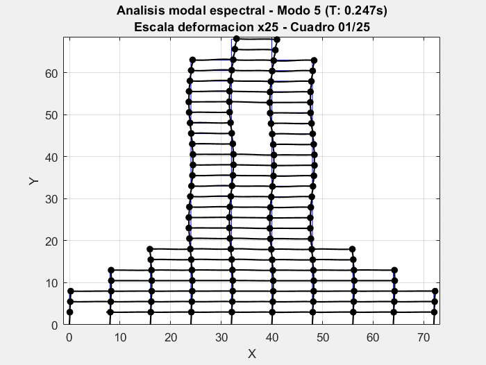

<h1 align="center">TEFAME</h1>

Resuelve estructuras de varios grados de libertad utilizando métodos numéricos matriciales

 

  

## Métodos de análisis

- Método de rigidez, análisis estático
- Método modal espectral
  - Cálculo valores y vectores propios con múltiples metodologías (Vectores ritz, matriz de barrido, inversión por desplazamiento)
  - Cálculo de energía y esfuerzos
  - Soporte a disipadores

## Tipo de elementos

- Biela 2D
- Biela 3D
- Fundación 2D
- Membrana2D (Shell 2D)
- Viga 2D
- Viga-columna 2D
- Viga-columna 3D

## Tipo de disipadores

- Friccional puro 2D
- Triangular 2D
- Viscoso 2D

## Patrones de carga

- Constante
- Dinámico

## Combinaciones de cargas

- Se da soporte a combinación elástica de cargas

## Tipo de cargas

### Estáticas

- Carga biela temperatura
- Carga distribuída en viga
- Carga distribuida en viga-columna
- Carga en nodo
- Carga membrana distribuída
- Carga puntual en viga
- Carga puntual en viga-columna

### Dinámicas

- Carga de pulso
- Carga genérica
- Carga sinusoidal
- Registro sísmico

## Documentacion

La documentación del proyecto se puede encontrar en [https://ppizarror.github.io/TEFAME/docs/](https://ppizarror.github.io/TEFAME/docs/)

## Autor

- Pablo Pizarro R. (pablo@ppizarror.com)
- Carlos López
- Jaime Reveco

## Licencia

Este proyecto está licenciado bajo la licencia MIT [https://opensource.org/licenses/MIT]
